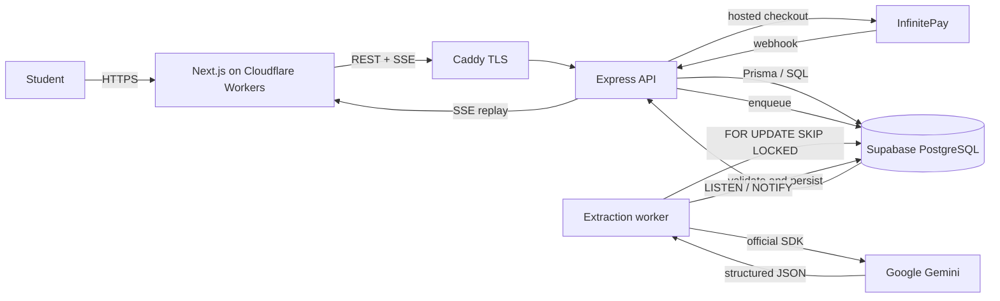

# MasterMe — Backend

MasterMe is a personal learning environment for self-taught students of programming and technical subjects. The backend turns books, articles, and notes into navigable concepts, evaluates whether a student can explain and apply them, and keeps the next study action grounded in evidence.

This repository contains the HTTP API, the asynchronous extraction worker, the PostgreSQL schema, the AI gateway, and the billing integration. The frontend lives in a separate repository.

For a nontechnical overview and the browser journey, start with the [project README](../README.md). This document then explains the backend design, complete API routes, local setup, and operations. The book-first journey still has open end-to-end and release acceptance work recorded in the [backlog](../backlog.md); an available route alone does not establish that the whole journey has passed acceptance.

- **API:** <https://masterme-api.duckdns.org>
- **Health:** <https://masterme-api.duckdns.org/health>
- **Frontend:** <https://github.com/J-V-S-C/MasterMe-Front>
- **Local OpenAPI UI:** <http://localhost:3333/docs> (disabled in production)

## Contents

- [The problem](#the-problem)
- [The solution](#the-solution)
- [What a student can do](#what-a-student-can-do)
- [Engineering highlights](#engineering-highlights)
- [Stack](#stack)
- [System architecture](#system-architecture)
- [Ingestion](#ingestion)
- [Asynchronous processing and realtime](#asynchronous-processing-and-realtime)
- [AI trust model, caching, and credits](#ai-trust-model-caching-and-credits)
- [Language and pedagogical evaluation](#language-and-pedagogical-evaluation)
- [API reference](#api-reference)
- [Security and ownership](#security-and-ownership)
- [Observability](#observability)
- [Local development](#local-development)
- [Data and migrations](#data-and-migrations)
- [Deployment](#deployment)
- [Operational response](#operational-response)
- [MVP limits and non-goals](#mvp-limits-and-non-goals)
- [Documentation](#documentation)

---

## The problem

Reading feels like learning. Recognizing a paragraph, highlighting it, or completing a chapter can create the illusion of understanding without producing knowledge the student can explain, apply to a new problem, or recall weeks later.

Self-taught students face a second problem: too many materials and no clear answer to “what should I study next?”. A library alone does not answer that question, and a chat interface that explains everything for them removes the retrieval effort that makes learning durable.

MasterMe addresses both problems:

1. **Evidence instead of the illusion of understanding.** The student must explain a concept in their own words. The answer is diagnosed against the source, not against the model's opinion.
2. **Continuity instead of an infinite pile of material.** Reading position, chapters, evidence, confidence, review dates, tasks, and available time feed a bounded recommendation for what to do now.

The product does not claim to measure global mastery. Declared confidence, a passed explanation, a completed task, and a delayed recall attempt are separate kinds of evidence.

## The solution

MasterMe is a full-stack, source-grounded study workspace:

- **Ingestion** accepts pasted text, PDF, Markdown, and TXT. Extraction runs asynchronously in a separate worker and produces concepts with descriptions, source excerpts, premises, and typed relationships.
- **Study** keeps the author's structure, shows the original passage, and asks concept-specific questions. Answers are evaluated as `PASSED`, `INCOMPLETE`, or `LOGICAL_BREAK` with a diagnosis and a next step.
- **Practice** ranks weak concepts deterministically before calling the model, then generates a Practice Project with objective, deliverables, constraints, and a first step. The project is a proposal; it is not executed or graded.
- **Planning** turns due reviews, observed gaps, unfinished chapters, explicit priorities, and available minutes into a small set of explainable actions. The student accepts, edits, or ignores each suggestion.
- **Billing and credits** protect provider cost with atomic per-user and global reservations. Each real generation attempt costs one internal credit; cache hits do not.

## What a student can do

| Capability | What the student gets |
| --- | --- |
| Import | Paste text or upload PDF, Markdown, or TXT, with progress, cancellation, and recovery. |
| Explore | A concept map with source excerpts, premises, and informative relationships. Edges never lock content. |
| Explain | A concept-specific question, a written answer, and a structured diagnosis grounded in the material. |
| Test an edge case | An optional scenario after an approved explanation, evaluated separately. |
| Declare confidence | A 1–5 self-report per concept, editable and removable. |
| Practice | A focused drill or a generated Practice Project, with deterministic focus and visible reasons. |
| Plan | Tasks, goals, plans spanning materials, a board, a calendar, availability, and a Today view. |
| Review | A conservative review schedule that expands after successful retrieval and resets after a gap. |
| Track | Evidence history, performance, contestations, and revisit suggestions, without a global mastery score. |

### Student journey

```text
add material
  → asynchronous extraction
  → concepts, source excerpts, relationships, chapter outline
  ├─ read the original source
  ├─ explain a concept
  │    ├─ diagnosis: PASSED / INCOMPLETE / LOGICAL_BREAK
  │    ├─ optional edge-case test
  │    └─ optional reasoning, application, or recall activity
  ├─ declare confidence
  ├─ focused drill on an observed gap
  └─ Practice Project
       ├─ automatic focus from available evidence
       └─ manual selection of up to five concepts

evidence + reviews + tasks + availability
  → Today suggestion (at most three, with a reason)
  → student accepts, edits, or ignores
```

No branch is a prerequisite for another. A passed explanation does not unlock content, and failing an edge case does not revoke the explanation.

---

## Engineering highlights

These are the parts of the backend that are most useful to discuss in a technical interview.

- **PostgreSQL job queue without extra infrastructure.** Jobs are claimed with `FOR UPDATE SKIP LOCKED`, protected by renewable leases, a heartbeat, bounded concurrency, delayed retries, and cooperative cancellation. Late provider results cannot overwrite a cancelled job.
- **Untrusted AI output.** Gemini is called through the official `@google/genai` SDK with JSON-schema-constrained output. The response is parsed, revalidated with Zod, and checked against source excerpts and concept references before persistence.
- **Deterministic product logic outside the model.** Practice focus, performance, review intervals, Today ranking, and credit accounting are deterministic and testable. The model writes text; it does not choose what the student should study.
- **Source provenance end to end.** Concepts keep UTF-16 offsets into the original text. Editorial units keep chapter order and page locations. Re-extraction creates a new active version without deleting the sessions, evidence, or projects tied to the previous one.
- **Realtime with recovery.** SSE uses PostgreSQL `LISTEN/NOTIFY` for low-latency wake-up and a persisted event table with `Last-Event-ID` replay. There is no per-client polling loop.
- **Server-authoritative security and billing.** The API validates Supabase JWTs and resource ownership. The frontend is not the authority for identity, balance, entitlement, or payment. Checkout is idempotent and entitlement is granted only after a server-to-server payment confirmation.
- **Cost control as a product invariant.** Credits are reserved atomically in PostgreSQL, respect daily, period, and global limits, and can be disabled with a kill switch. An availability fallback attempt costs another credit, and the UI shows conservative estimates.

## Stack

| Layer | Technology |
| --- | --- |
| Runtime | Bun, strict TypeScript |
| HTTP | Express 5, Zod boundary validation, OpenAPI + Swagger UI |
| Persistence | PostgreSQL 17, Prisma ORM for new adapters, safe SQL for locks and specialized queries |
| Queue | PostgreSQL `processing_jobs` with `SKIP LOCKED`, leases, and `LISTEN/NOTIFY` events |
| AI | Official `@google/genai` SDK, structured output, Zod, content-hash caching |
| Auth | Supabase Auth, JWT/JWKS validation in the API, `owner_id` isolation |
| Payments | InfinitePay hosted checkout, webhook trigger, server-to-server reconciliation |
| Files | Local OCI volume for originals; PDF parsing with Poppler `pdftohtml` |
| Ops | Docker Compose, Caddy, GitHub Actions, GHCR, `/health`, `/ready`, Prometheus text metrics |
| Tests | Bun test, real PostgreSQL for integration, in-memory fakes only for external boundaries |

## System architecture



The API and worker are separate processes built from the same image. They share PostgreSQL but have independent pools and lifecycles. Only the API is exposed publicly; Caddy terminates TLS and forwards to `127.0.0.1:3333`.

### Layering

The backend is a modular monolith moving incrementally toward DDD. Dependencies point inward:

```text
HTTP (Express, Zod, controllers)
  → application (use cases, contracts, ports, transactions)
    → domain (invariants, aggregates, pure services)
  ← infrastructure (PostgreSQL, Prisma, Gemini, files, queue, payments)
```

- `src/infra/http/` validates and translates HTTP; controllers do not decide business rules.
- `src/application/services/` coordinates use cases and transactions.
- `src/application/contracts/` holds named service interfaces and API types.
- `src/application/repositories/` holds persistence ports; `src/application/ports/` holds external gateways.
- `src/infra/` implements those ports for PostgreSQL, Prisma, Gemini, files, SSE, and payments.
- `src/main/` composes the API and worker through factories. Routers only associate middleware and handlers.
- Domain code does not import Express, Prisma, SDKs, filesystem, or UI.

`StudySessionAggregate` and `BillingOrderAggregate` protect part of the lifecycle rules; the migration of other flows is still in progress. `PracticeFocusService` is a pure domain service. `MasterMeService` still concentrates legacy use cases, and `LearningWorkspaceService` is the current workspace boundary.

### Key decisions and trade-offs

| Decision | Why | Cost accepted |
| --- | --- | --- |
| PostgreSQL as the job queue | Jobs, leases, study data, and events already share one transactional store. No second broker to operate. | Database load and lower ceiling than a dedicated queue; acceptable at current scale. |
| Deterministic ranking before the LLM | Focus must be explainable, reproducible, and testable without provider access. | Product rules live in code and must evolve with evidence, not prompt tweaks. |
| Structured output plus local validation | Model output is untrusted data. A valid JSON shape is not a valid domain result. | Extra schema, repair, and source-grounding code on every AI path. |
| Versioned, additive extraction | Re-extraction must not erase sessions, evidence, or projects. | Historical concepts and jobs accumulate; cleanup requires an explicit decision. |
| SSE with a persisted event log | Progress must survive reconnects and multiple tabs. | One extra `LISTEN` connection and an event table. |
| API owns auth and ownership | The frontend must never be the authority for access or balances. | Every resource read repeats an ownership check. |
| Idempotent billing | A webhook is a trigger, not proof of payment. Replays must not duplicate access. | A small order/event state machine with leases and reconciliation. |
| Modular monolith | One deployable unit keeps operations simple while boundaries mature. | The migration to DDD is incomplete and must be finished incrementally. |
| Prisma plus safe SQL | Mature persistence tooling without losing precise locking. | Two persistence styles coexist during migration. |

### Repository layout

```text
src/
  application/        contracts, domain, ports, repositories, services, prompts
  config/             environment schema and parsing
  docs/               OpenAPI document
  infra/
    controllers/      HTTP translation
    http/             app, routers, operational endpoints
    ingestion/        upload, parsing, queue, worker
    llm/              Gemini gateway and structured client
    parsers/          PDF, Markdown, TXT parsing
    payments/         InfinitePay client
    repositories/     Prisma, PostgreSQL, in-memory adapters
    events/           LISTEN/NOTIFY and SSE hub
  main/               API and worker composition, factories, jobs
  middleware/         auth, ownership, validation, rate limits, errors, metrics
  schemas/            Zod request/response schemas
prisma/migrations/    the only source of SQL migrations
deploy/               production Compose, environment example, deploy script
test-fixtures/        reproducible PDFs and documents for parser tests
scripts/              validation, baseline, and benchmark scripts
```

---

## Ingestion

Ingestion is the only asynchronous product flow. It is deliberately separated from the request lifecycle: uploading returns `202`, the worker does the expensive work, and the browser follows progress through SSE with polling as a fallback.

### Pipeline

```text
upload or paste
  → validate limits and ownership
  → persist material and original file
  → insert processing job (QUEUED)
  → worker claims job with SKIP LOCKED
  → PREPARING   load text, repair index if needed, choose chapters
  → EXTRACTING  call Gemini per part, validate, persist chapter checkpoints
  → REDUCING    select the final concept set across parts
  → READY       activate the new extraction version atomically
```

Failure paths keep the previous active version readable. A retry reuses the same job and skips completed chapter checkpoints. Cancellation stops future chapters and rejects late results.

### Input limits

| Input | Limit |
| --- | --- |
| Pasted text | 500,000 characters per request |
| PDF, Markdown, TXT | 20 MiB |
| PDF pages | 800 |
| Upload rate | 8 per 15 minutes and 24 per day per account |
| Upload concurrency | 2 globally, 1 per IP, 1 per account |
| Extraction parts | Up to 100,000 characters of indexed text per call |
| Evidence span | Up to 1,600 characters, preferring sentence or word boundaries |
| Concepts | 12 by default, configurable from 1 to 30 |
| Extraction concurrency | 1 by default on the 1 GB VM |

### PDF handling

`pdftohtml` from Poppler runs in a subprocess with a timeout, virtual-memory limit, output limit, and the 800-page ceiling. The Docker image installs `poppler-utils` and `prlimit`. Outside the container, install Poppler and `prlimit` (util-linux) to test PDF upload.

The XML SAX parser preserves only outline data that locates headings on pages. Without a reliable outline, the material remains a single unit; chapters are never invented. Textless or image-only PDFs are rejected because there is no OCR.

### Books, chapters, and checkpoints

Book uploads with a named top-level section are extracted one chapter at a time in author order. Each completed chapter is committed and recorded in `processing_job_units`. If a later chapter fails, completed chapters remain readable. Automatic and manual retries reuse the same job and skip completed chapters. Cancelling stops future chapter commits.

A chapter heading is a guide, not evidence. The worker reads the corresponding body and selects source-backed concepts, including significant named topics when they are central, while excluding participants, class names, index letters, and incidental headings.

### Re-extraction and versioning

Each completed extraction identifies a version. `GET /api/materials/:id/status` exposes `activeExtractionJobId`; `null` means legacy concepts. A new extraction activates its concepts and relationships only in the transaction that concludes the job. Old concepts remain for existing sessions, evidence, and files. If the new extraction fails or is cancelled, the previous version stays active.

`GET /api/materials/:id/extract/preview` estimates planned topics and base credits without consuming AI or changing the material. Migration `038_material_source_snapshots` preserves the original source needed to repair a derived PDF text index.

---

## Asynchronous processing and realtime

### Queue

- Jobs live in `processing_jobs` and are claimed with `FOR UPDATE SKIP LOCKED`.
- A claim sets `PROCESSING`, increments `attempts`, and records `locked_at`.
- The worker renews its lease with a heartbeat while a long provider call is running.
- A lease older than five minutes can be reclaimed. This prevents a crashed worker from blocking a job forever.
- Retries are delayed by 30 seconds and stop after three attempts.
- `run_after` supports delayed retries without a separate scheduler.
- Cancellation is cooperative: it prevents future work and persistence of a late result. It does not promise that a request already accepted by the provider stopped consuming resources.
- The worker removes pending original-file deletions from `material_file_deletions`; if the volume fails, the pending record remains for a later attempt.

### SSE

- `GET /api/events` streams authenticated events.
- Events are filtered by `owner_id`, persisted before notification, and accept `Last-Event-ID` for replay.
- One PostgreSQL `LISTEN` connection fans notifications out to SSE clients; there is no per-client query loop.
- Progress uses meaningful stages rather than a fabricated percentage for one long call.
- The browser falls back to polling and reconciles active work periodically.

---

## AI trust model, caching, and credits

### Trust model

Model output is treated as untrusted:

1. The request uses an explicit, source-grounded context. There is no RAG, embedding, or LangGraph dependency.
2. Generation is constrained by JSON Schema.
3. The response is parsed as JSON and revalidated with Zod.
4. Source excerpts are checked against the original material.
5. References to nonexistent concepts are rejected.
6. Invalid output is never treated as a successful domain result.

Extraction, question-set generation, evaluation, edge-case generation, localization, and project generation have separate prompts, schemas, and token budgets. Provider failures are classified for retries and user-facing errors without exposing raw payloads.

### Caching

- Identical practice-project inputs reuse the `practice_projects` cache.
- A question set is cached by concept content, locale, and variant; explanation, reasoning, application, challenge, retention, and focused-practice questions are generated together on first use.
- Evaluations use a content hash over activity type, prompt, prompt version, criteria, source excerpt, and offset.
- A cache hit does not consume a credit.
- Stable private GETs return `ETag` and `Cache-Control: private, max-age=0, must-revalidate`; volatile data, mutations, quota, and SSE use `no-store`.

### Credits

| Plan | Daily limit | Period limit |
| --- | --- | --- |
| Free | 100 | None; period fields mirror the day for compatibility |
| Essential (R$ 29.90 / 30 days) | 120 | 1,500 per 30 days |
| Pro (R$ 249.00 / 365 days) | 180 | 15,000 per 365 days |

- Every real generation attempt costs **1 credit**, including an availability fallback attempt.
- A credit represents a request sent, not tokens or guaranteed provider capacity.
- Consumption is reserved atomically in PostgreSQL and respects the daily limit, the period limit, `AI_GLOBAL_DAILY_CREDIT_LIMIT`, and the kill switch `AI_CREDITS_ENABLED`.
- `GET /api/billing/me` is the authoritative source of balance. `GET /api/ai-usage/today` remains only for call/token telemetry compatibility.
- The interface displays MasterMe's internal balance, which is independent of Google AI Studio limits.

### Provider limits and extraction pacing

The free-tier models have different provider ceilings, and both quotas are shared by every request that uses the same API key:

| Model | RPM | TPM | RPD |
| --- | ---: | ---: | ---: |
| `gemini-3.5-flash-lite` | 15 | 250K | 500 |
| `gemini-3.6-flash` | 5 | 250K | 20 |

- Extraction starts at `EXTRACTION_REQUESTS_PER_MINUTE` requests per minute (default `3`, capped at `4`) and also enforces a rolling 200K-token budget. A 100K-character prompt plus its 6K output reserve stays below the 250K TPM ceiling at the default pace.
- A per-minute or per-token `429` pauses extraction; the job is retried on the same model after the provider's `retryDelay`, or after roughly 70 seconds when the provider does not send one. It does not consume the fallback model.
- A per-day `429` blocks that model until the next quota reset (just after midnight Pacific) and marks the extraction job as non-retryable with `AI_QUOTA_EXHAUSTED`. Extraction never falls back to the secondary model on a quota error, because `gemini-3.6-flash` has only 20 requests per day.
- Within a generation request, fallback is reserved for unavailable models (`503`), missing models, and invalid structured output. Those attempts still consume a credit.
- Pacing state is per process: the API and worker each own a limiter. Keep one extraction worker and avoid concurrent manual extraction, or add a shared limiter before scaling.
- The Free plan's 100 credits/day sit below Lite's 500 RPD, but a shared key, retries, and interactive requests all draw from the same provider quota. Keep `AI_GLOBAL_DAILY_CREDIT_LIMIT` at or below the Lite RPD (500), and lower it when the key also serves interactive traffic.

AI operations are: `EXTRACTION`, `QUESTION_SET_GENERATION`, `INITIAL_EVALUATION`, `EDGE_CASE_GENERATION`, `EDGE_CASE_EVALUATION`, `PRACTICE_PROJECT`, `LOCALIZATION`, `STRESS_EVALUATION`, and `ISOMORPHIC_PROBLEM`.

## Language and pedagogical evaluation

- New materials default to `pt-BR` and accept `pt-BR` or `en-US`.
- Concepts, questions, diagnoses, and projects are generated in the language of the material. The source excerpt remains literal.
- Old content can be localized with `POST /api/materials/:id/localize`. The operation consumes one AI credit, is idempotent when the language already matches, and preserves IDs, relationships, evidence, and sessions.
- A question must be answerable from its cited source. It must not require a comparison unless the source explains both sides.
- An explanation question asks the student to reconstruct the mechanism instead of restating the answer in the question. Reasoning asks for an inference, application gives a concrete situation, and recall withholds the source. Every generated question must be specific to the concept and answerable from its source; paraphrases are allowed. The server does not substitute generic templates or use word overlap to reject generated questions. New question bundles use `question-bundle-v3`; an unanswered question produced by the retired fixed fallback is replaced on the next Study visit, while saved questions and answers remain in history. A student can explicitly generate another question for any other older unanswered session.
- The generation prompt excludes definition-only questions and asks for reasoning tied to the cited concept. The structured response schema validates the fields returned by the provider.
- Contrast and whole-part relationships do not require causality. Only causal relationships must state a mechanism.
- Source excerpts are capped at 1,600 characters and prefer sentence or word boundaries while preserving exact offsets. The cap narrows citations; it does not guarantee semantic correctness.

---

## API reference

### Conventions

- Base URL: `http://localhost:3333` locally, `https://masterme-api.duckdns.org` in production.
- All `/api` routes require a Supabase bearer token unless marked **Public**.
- JSON bodies are limited to 110 KiB; the billing webhook is limited to 16 KiB.
- Errors have the shape `{ "code", "message", "requestId" }`. `requestId` also appears in logs.
- `401` means an invalid or missing token. `503 AUTH_UNAVAILABLE` means the signing key could not be fetched; it is not an authentication decision.
- `429` means a rate limit or credit limit. `409` means an invalid state transition or concurrent change; reload before retrying.
- The AI column uses `—` for no AI call, `1` for one credit, `0–1` when a cache hit is free, and `1 per call` for extraction, which may call the provider once per part.
- All learning routes live under `/api/learning` and require the same authentication and AI burst limits as the rest of `/api`.

### Operational

| Method | Route | Purpose | AI |
| --- | --- | --- | --- |
| GET | `/health` | Liveness check without dependencies. | — |
| GET | `/ready` | Readiness check that queries PostgreSQL with a timeout; deployment gate. | — |
| GET | `/metrics` | Prometheus text metrics. Requires an operational bearer token; returns `404` when unset. | — |
| GET | `/openapi.json` | Raw OpenAPI document. Development only. | — |
| GET | `/docs` | Swagger UI. Development only. | — |
| GET | `/api` | Authenticated API index with the current endpoint list and version. | — |

### Ingestion and materials

| Method | Route | Purpose | AI |
| --- | --- | --- | --- |
| POST | `/api/materials` | Creates a material from pasted text. | — |
| GET | `/api/materials` | Lists metadata without full content. | — |
| GET | `/api/materials/:id` | Fetches one material's content on demand. | — |
| PATCH | `/api/materials/:id/kind` | Corrects `BOOK`, `ARTICLE`, or `TEXT`; rejected while extraction is active. | — |
| DELETE | `/api/materials/:id` | Deletes the material and its history; original-file cleanup is durable and asynchronous. Rejected while extraction is active. | — |
| POST | `/api/materials/upload` | Uploads PDF, Markdown, or TXT and queues processing. Returns `202`. | — |
| GET | `/api/materials/:id/file` | Returns the original PDF to its owner for page reading. | — |
| POST | `/api/materials/:id/extract` | Queues or resumes extraction. Returns `202`. | 1 per call |
| DELETE | `/api/materials/:id/extract` | Cancels an active extraction and discards its late result. | — |
| GET | `/api/materials/:id/status` | Returns processing status, stage, progress, attempts, and `activeExtractionJobId`. | — |
| GET | `/api/materials/:id/extract/preview` | Estimates topics and base credits for a new extraction without consuming AI. | — |
| GET | `/api/events` | Streams authenticated processing and AI events over SSE, with replay. | — |
| GET | `/api/processing/overview` | Queue counts and oldest pending job for operations. | — |

**Upload example**

```bash
curl -X POST http://localhost:3333/api/materials/upload \
  -H "Authorization: Bearer $TOKEN" \
  -F "file=@book.pdf" \
  -F "title=Designing Data-Intensive Applications" \
  -F "locale=en-US" \
  -F "materialKind=BOOK"
```

**SSE example**

```bash
curl -N http://localhost:3333/api/events \
  -H "Authorization: Bearer $TOKEN" \
  -H "Last-Event-ID: 42"
```

### Concepts, outline, and source navigation

| Method | Route | Purpose | AI |
| --- | --- | --- | --- |
| GET | `/api/materials/:id/concepts` | Lists the active concepts of a material. | — |
| GET | `/api/materials/:id/knowledge-map` | Returns the map, explanation status, and edge-case state. | — |
| POST | `/api/materials/:id/localize` | Localizes generated content without changing IDs, evidence, or history. | 1 |
| GET | `/api/learning/materials/:materialId/outline` | Returns the ordered editorial outline with provenance and pages when available. | — |
| GET | `/api/learning/materials/:materialId/outline-state` | Returns the outline revision and original headings for safe editing. | — |
| PATCH | `/api/learning/materials/:materialId/outline` | Replaces the ordered outline using an expected revision; preserves existing IDs and offsets. | — |
| GET | `/api/learning/materials/:materialId/reading-position` | Returns the saved reading position. | — |
| PUT | `/api/learning/materials/:materialId/reading-position` | Saves the reading position. | — |
| GET | `/api/learning/materials/:materialId/relations` | Lists typed, source-anchored relationships for one material. | — |
| POST | `/api/learning/relations` | Creates a student-justified relationship between two concepts in the same material. | — |

### Study, questions, and evidence

| Method | Route | Purpose | AI |
| --- | --- | --- | --- |
| POST | `/api/concepts/:id/sessions` | Starts an explanation and generates or reuses a custom question set for the concept. The generated wording is preserved, including valid paraphrases of the source. | 0–1 |
| GET | `/api/concepts/:id/sessions` | Lists saved sessions and answers for one owned concept, newest first. | — |
| GET | `/api/sessions/:id` | Retrieves one session and its current state. | — |
| POST | `/api/sessions/:id/answers` | Evaluates the initial answer; `PASSED` concludes that explanation. | 1 |
| POST | `/api/sessions/:id/edge-case` | Creates or recovers an opt-in edge case after approval. | 1 |
| POST | `/api/sessions/:id/edge-case/answers` | Evaluates the edge case without downgrading the explanation. | 1 |
| GET | `/api/materials/:id/sessions` | Lists current and historical attempts for one material. | — |
| GET | `/api/materials/:id/confidences` | Lists existing self-reported confidence. | — |
| PUT | `/api/concepts/:id/confidence` | Creates or updates confidence from 1 to 5. | — |
| DELETE | `/api/concepts/:id/confidence` | Removes confidence. | — |
| GET | `/api/materials/:id/performance` | Exposes deterministic performance by concept using initial attempts only. | — |
| POST | `/api/learning/concepts/:conceptId/activity-prompts` | Returns reasoning, application, challenge, retention, and recall prompts from the same cached set. | 0–1 |
| GET | `/api/learning/materials/:materialId/questions` | Lists active objectives and immutable versions of answered questions with source and extraction version. | — |
| POST | `/api/learning/materials/:materialId/drill` | Chooses a focused practice question from the cached set. | 0–1 |
| POST | `/api/learning/activities/answers` | Evaluates explanation, reasoning, application, or recall with grounded feedback. | 1 |
| GET | `/api/learning/materials/:materialId/evidence` | Returns distinct evidence history by activity. | — |
| POST | `/api/learning/evidence` | Records declared or contested evidence; the client cannot approve an evaluation. | — |
| POST | `/api/learning/evidence/:id/contestations` | Contests a diagnosis without overwriting the original evaluation. | — |
| POST | `/api/learning/evidence/:id/revisit` | Requests a revisit of an owned attempt without creating a task before acceptance. | — |
| GET | `/api/learning/suggestions` | Lists recommendations with reason, question, diagnosis, source, and previous attempt. | — |
| POST | `/api/learning/suggestions/:id/decision` | Accepts or ignores a suggestion; acceptance creates a task once and only once. | — |

**Evidence semantics**

- Declared confidence, a passed explanation, application, recall, task completion, and a revisitation are separate evidence. None of them creates a global mastery score.
- `PASSED` approves that explanation only. It does not approve application, retention, or the whole material.
- `INCOMPLETE` means semantically correct but ambiguous or incomplete. `LOGICAL_BREAK` is reserved for contradiction, reverse causality, or an incorrect mechanism.
- Performance uses initial explanation attempts only. Edge-case results never affect it.
- Assisted answers, hints, and revealed solutions remain distinguishable from independent attempts. `hintsUsed` requires `assisted=true`.
- A new attempt can link to the previous evidence only when it belongs to the same account, material, activity, concept, and relationship.
- Review intervals expand through 1, 3, 7, 14, 30, and 60 days after successful retrieval. Failures, assisted answers, and revealed solutions reset the next interval to one day. A successful application or reasoning activity does not erase a longer interval already earned by retrieval. `SELF_REPORTED` and `CONTESTED` evidence never creates or updates a review schedule.
- Due reviews remain suggestions until the student opens or schedules them. Historical schedules are never backfilled silently, and completing a task does not change review evidence.
- A diagnosis may suggest a revisit with a source. Only student confirmation adds or edits a task. Ignoring a suggestion blocks nothing and deletes nothing.

### Plans, tasks, and reviews

| Method | Route | Purpose | AI |
| --- | --- | --- | --- |
| GET | `/api/learning/shelves` | Lists private shelves and their materials. | — |
| POST | `/api/learning/shelves` | Creates or recovers a shelf by name. | — |
| DELETE | `/api/learning/shelves/:id` | Removes a shelf without deleting its materials. | — |
| PUT | `/api/learning/shelves/:id/materials/:materialId` | Adds an owned material to a shelf idempotently. | — |
| DELETE | `/api/learning/shelves/:id/materials/:materialId` | Removes a material from a shelf without deleting the material. | — |
| GET | `/api/learning/cards` | Lists private index cards that reference concepts. | — |
| PUT | `/api/learning/cards/:conceptId` | Saves or updates a card without duplicating the concept. | — |
| DELETE | `/api/learning/cards/:conceptId` | Removes a card without deleting the concept. | — |
| GET | `/api/learning/goals` | Lists personal goals. | — |
| POST | `/api/learning/goals` | Creates a personal goal with an optional deadline. | — |
| PATCH | `/api/learning/goals/:id` | Edits a goal, including its optional deadline. | — |
| GET | `/api/learning/plans` | Lists plans with ordered materials. | — |
| POST | `/api/learning/plans` | Creates a plan from a goal and an ordered collection of owned materials. | — |
| PATCH | `/api/learning/plans/:id` | Edits title, goal, or material order. | — |
| PUT | `/api/learning/plans/:id/tasks/order` | Reorders all active plan tasks atomically without changing editorial order. | — |
| GET | `/api/learning/tasks` | Lists tasks and statuses without inferring learning from completion. | — |
| POST | `/api/learning/tasks` | Creates a task linked to a plan, material, unit, concept, review, or project. | — |
| PATCH | `/api/learning/tasks/:id` | Edits task fields, links, schedule, duration, or status. | — |
| PUT | `/api/learning/tasks/order` | Reorders all active tasks and board stages atomically. | — |
| GET | `/api/learning/availability` | Lists the student's weekly availability. | — |
| PUT | `/api/learning/availability` | Saves availability for one weekday. | — |
| GET | `/api/learning/desk` | Returns the Day Desk: tasks, available minutes, and overload for an explicit timezone. | — |
| GET | `/api/learning/today` | Suggests at most three feasible actions with reasons and durations; never creates a task. | — |
| GET | `/api/learning/reviews/due` | Lists due reviews as suggestions without changing the schedule. | — |
| POST | `/api/learning/reviews/:id/reminder` | Postpones or skips an owned review without completing learning. | — |

### Practice

| Method | Route | Purpose | AI |
| --- | --- | --- | --- |
| GET | `/api/materials/:id/practice-context` | Aggregates map, confidence, performance, and project history in one read. | — |
| POST | `/api/materials/:id/practice-focus` | Previews up to three active gaps and their reasons without consuming AI. | — |
| POST | `/api/materials/:id/practice-projects` | Generates or recovers a cached Practice Project. | 0–1 |
| GET | `/api/materials/:id/practice-projects` | Lists Practice Projects for a material, newest first. | — |
| GET | `/api/practice-projects/:id` | Retrieves one Practice Project. | — |

Practice focus accepts `focusMode` as `OVERVIEW`, `MANUAL`, `CONFIDENCE`, `PERFORMANCE`, or `COMBINED`, plus `conceptIds` when the mode allows. Ranking and reasons are calculated before Gemini. Modes without usable signals return `422`; there is no hidden fallback. The frontend exposes only automatic focus and manual selection.

### Billing

| Method | Route | Purpose | AI |
| --- | --- | --- | --- |
| GET | `/api/billing/catalog` | **Public.** Returns the plan catalogue and credit weights. Without `INFINITEPAY_HANDLE`, only `FREE` is returned. | — |
| POST | `/api/billing/checkouts` | Creates or recovers an idempotent hosted checkout. Requires `Idempotency-Key`; only `planId` is accepted. | — |
| POST | `/api/billing/orders/:id/reconcile` | Reconciles an owned order with InfinitePay before granting access. | — |
| POST | `/api/billing/webhooks/infinitepay` | **Public.** Persists a payment signal and schedules reconciliation. It never grants entitlement directly. | — |
| GET | `/api/billing/me` | Returns plan, entitlement validity, balance, weights, and conservative per-operation estimates. | — |

The webhook is a trigger, not proof. Entitlement is granted only after a server-to-server `payment_check` confirms payment and value, with idempotent order, transaction, and entitlement records. The API never receives or stores card data.

**Billing rules**

- Empty `INFINITEPAY_HANDLE` is the free release mode: the catalogue exposes only `FREE`; checkout, HTTP reconciliation, and the webhook return `404`; the reconciler does not start. `GET /api/billing/me` and credit reservations remain active. Activating payments requires the provider configuration and the matching frontend release.
- Essential (R$ 29.90 / 30 days) and Pro (R$ 249.00 / 365 days) are single payments without automatic renewal.
- Repurchases extend only the same tier. If Essential and Pro are active at the same time, Pro has priority and only its credits are consumed. Essential validity and balance are neither promoted nor incorporated into Pro.
- The frontend sends only `planId` and `Idempotency-Key`. Price, description, redirects, and webhook are defined by the backend from `PUBLIC_APP_URL`.
- Competing events are admitted atomically, with at most five pending events per order. The in-memory reconciler coalesces triggers, and PostgreSQL leases limit all replicas to five active events, up to one per request. `paid=false` closes an event; an identical replay stays terminal, and only a genuinely new signal creates another attempt.
- Payment records hold only technical IDs, value, plan, and state required for reconciliation.


### Legacy compatibility

These routes remain available for the previous frontend during the compatibility window. New consumers should use the learning workspace and Practice Project.

| Method | Route | Purpose | AI |
| --- | --- | --- | --- |
| POST | `/api/sessions/:id/stress-replies` | Legacy alias for edge-case evaluation. | 1 |
| POST | `/api/materials/:id/isomorphic-problem` | Generates a legacy isomorphic problem. | 1 |
| GET | `/api/materials/:id/isomorphic-problem` | Returns a cached legacy isomorphic problem. | — |
| GET | `/api/ai-usage/today` | Legacy call/token telemetry. Use `/api/billing/me` for balance. | — |

---

## Security and ownership

- Supabase Auth is the identity provider. The API validates the token and fetches signing keys from Supabase JWKS.
- Every owned resource is filtered by `owner_id`. The API checks ownership before reading UUID resources; the frontend is never the authority.
- The frontend BFF forwards only the session token. It does not forward arbitrary browser cookies or headers to the API, and it does not grant entitlement.
- A signing-key lookup failure returns `503 AUTH_UNAVAILABLE`; an invalid token returns `401`.
- Upload and AI routes have per-IP and per-user limits. Production should also keep rate limiting in Caddy/Cloudflare.
- The Gemini key exists only in the backend and must be exclusive, restricted, and rotated.
- Logs and metrics use allowlisted fields and route templates. They never include content, queries, tokens, emails, `owner_id`, or material/request/transaction IDs.
- Security headers: `nosniff`, `DENY` framing, `no-referrer`, restrictive permissions policy, and HSTS in production.
- Material deletion removes linked history and records the original-file key in `material_file_deletions` in the same transaction. The worker removes the file and clears the pending record; a failure leaves the record for a later attempt.

### Rate limits

| Scope | Limit |
| --- | --- |
| Global per IP | 600 requests / 15 minutes |
| AI-capable route per user | 20 requests / minute |
| Upload per account | 8 / 15 minutes and 24 / day |
| Upload concurrency | 2 global, 1 per IP, 1 per account |
| Checkout / reconciliation per user | 10 / 15 minutes |
| Payment webhook per IP | 120 / minute |

Responses include `ratelimit-limit`, `ratelimit-remaining`, `ratelimit-reset`, and `retry-after` when limited.

---

## Observability

- `GET /health` is liveness without dependencies.
- `GET /ready` checks PostgreSQL with a timeout and is the deployment gate.
- `GET /metrics` exposes RED, AI, credits, queue, and billing series in Prometheus text format only with an operational bearer token. Without a configured token it returns `404`; with a wrong token it returns `401`.
- Metric labels use enums and route templates, never IDs or content.
- Memory counters restart with the process. Queue gauges and 24-hour AI aggregates come from PostgreSQL.
- JSON logs go to stdout. Extraction failures include the stage, attempt, retry decision, safe failure reason, and available application/HTTP/system codes, but not raw provider messages, uploaded content, or student/material IDs.

The current Prometheus endpoint does not mean that Prometheus collection, Grafana dashboards, or OpenTelemetry tracing are running in production. The chosen direction is the OpenTelemetry, Prometheus, and Grafana stack; it will be declared operational only when collection, storage, dashboards, and alerts work together.

Initial objectives, subject to adjustment with real data:

- API without 5xx in 99.5% of requests over a 30-day window.
- p95 below 2.5 s outside SSE.
- Investigate a queue job older than 5 minutes; treat 15 minutes as critical.
- Investigate provider failures above 10% in 15 minutes.

Local private collection:

```bash
curl --fail -H "Authorization: Bearer $METRICS_BEARER_TOKEN" \
  http://127.0.0.1:3333/metrics
```

---

## Local development

```bash
# Configure GEMINI_API_KEY and SUPABASE_URL in the private .env file.
docker compose --env-file .env --env-file .env.development up --build
```

The local Compose starts API, worker, and PostgreSQL 17 in its own volume. It mounts the backend source and migration files and runs API and worker with Bun watch mode. Edits to backend TypeScript restart the affected process. New migrations run when the API container starts; restart it after adding a migration. Rebuild the image when dependencies, the Prisma schema, or the Dockerfile change, because those are not hot reloaded.

The frontend stays outside Docker. `SUPABASE_URL` authenticates users; application data is in the local PostgreSQL. After validating the token, the backend registers the authenticated ID in the local `auth.users` table to satisfy foreign keys. The Gemini key may be shared between environments, which also shares the same provider quota.

### Validation

```bash
docker compose --env-file .env --env-file .env.development up -d test-db
bun install
bun run validate
```

`bun run validate` runs Prisma generation, strict type checking, and the test suite. Integration tests require the test database on `127.0.0.1:5433`. `MIGRATION_TEST_REQUIRED=true` makes the suite fail instead of skipping when that database is missing. The suite erases schemas in the test database.

Install the versioned pre-commit hook once per clone:

```bash
git config --local core.hooksPath .githooks
```

It runs `scripts/ci-local.sh` before every commit: PostgreSQL integration tests, dependency audit, production Compose validation, image build, and image smoke test. Keep Docker running and stage all changes before committing.

### Useful commands

```bash
# API and worker logs
docker compose --env-file .env --env-file .env.development logs -f --tail=0 api
docker compose --env-file .env --env-file .env.development logs worker

# Restart the API after a migration
docker compose --env-file .env --env-file .env.development restart api

# Parser baseline without AI
bun scripts/measure-phase2-baseline.ts

# Live AI benchmark on synthetic fixtures; consumes provider quota
PHASE2_LIVE_BENCHMARK=1 bun --env-file=.env scripts/measure-phase2-ai.ts
```

`PHASE2_FIXTURE_OFFSET` and `PHASE2_FIXTURE_LIMIT` restrict the live sample. The benchmark does not write to the database, disables model fallback, does not print keys or user text, and reports model, tokens, duration, and anchor diagnosis.

If login succeeds but data requests fail after the host changes networks, inspect `/etc/resolv.conf` inside the API container. Docker may retain old DNS forwarders. Recreate the API and worker and confirm the container can reach the Supabase JWKS endpoint.

---

## Data and migrations

- `prisma/migrations/` is the only source of SQL migration files.
- `bun run migrate` reads those files and preserves the names and checksums of the ledger already present in production. Do not run `prisma migrate deploy` against that database without first reconciling Prisma's history with the ledger.
- Migrations are additive and compatible. A partial schema or an altered historical migration must fail, never be silently reapplied.
- An application rollback uses the previous image without reverting the schema. Destructive cleanup requires a separate decision.
- `dev/postgres-init.sql` creates only the `auth.users` table that Supabase already provides locally.
- The Prisma adapter migration is gradual and does not change the rollout rule.

Important migration boundaries:

- `023_extraction_versions` — a new extraction activates a new concept set without deleting historical sessions.
- `024_evidence_context` — immutable question version, criteria, hints, and previous attempt context.
- `025_source_offsets` — source offsets for provenance.
- `030_learning_reviews` — conservative review schedule.
- `031_material_kind` and `032_editable_outline` — material kind and revisioned outline editing.
- `033_chapter_checkpoints` — chapter-level commits and resumable extraction.
- `034_question_versions` — immutable objectives and question snapshots.
- `035_attempt_context` — distinguishes Study, Drill, and Review evidence.
- `036_task_project_link` — optional owner-checked project reference on a Practice task.
- `037_question_set_credits` — bundles question generation into one credit operation.
- `038_material_source_snapshots` — preserves the original source for index repair.

---

## Deployment

Backend and frontend are independent Git repositories. `development` integrates; `main` publishes. The frontend runs on Cloudflare Workers; API, worker, and uploads run on OCI; PostgreSQL and authentication are in Supabase. Backend images are published to GHCR by commit SHA.

The VM needs Docker Engine, Compose, and an HTTPS proxy. Caddy forwards to `127.0.0.1:3333` and must preserve SSE on `/api/events`.

### Production configuration

Use the Supabase **Session pooler** on port 5432 with `sslmode=require`; hide reserved characters in the password. API and worker use independent pools (`DATABASE_POOL_MAX=3` as the initial operating value).

On the VM, copy `deploy/.env.example` to `/opt/masterme/.env` with mode `600` and define:

- `DATABASE_URL`
- `SUPABASE_URL` over HTTPS
- `GEMINI_API_KEY`
- `AI_GLOBAL_DAILY_CREDIT_LIMIT`
- `AI_CREDITS_ENABLED`

`PUBLIC_APP_URL` defaults to the frontend URL in `deploy/.env.example`; set it on the VM only if the canonical HTTPS origin changes. The example limits global consumption to 500 credits/day. Leave `INFINITEPAY_HANDLE` and `METRICS_BEARER_TOKEN` empty for the free release: payments and `/metrics` are disabled. A metrics token must have at least 32 characters and should be configured only when private collection exists.

GitHub's `production` environment requires `OCI_HOST`, `OCI_SSH_USER`, `OCI_SSH_KEY`, and `OCI_KNOWN_HOSTS`. Obtain the host key through a reliable channel; do not accept an unknown key in the workflow.

### Caddy example

The metric rule comes **before** the proxy:

```caddyfile
api.seudominio.com {
  @operational path /metrics /metrics/*
  respond @operational 404
  request_body {
    max_size 24MB
  }
  reverse_proxy 127.0.0.1:3333
}
```

Expose only 80/443 publicly. Apply rate limiting at the proxy for API, upload, SSE, and webhook. The 24 MB ceiling leaves room for multipart overhead around a 20 MiB file; the API enforces the file limit. Set a timeout for slow uploads. The InfinitePay webhook is public, accepts at most 16 KiB, and only triggers reconciliation.

### CI/CD

CI requires disposable PostgreSQL 17 for integrations, dependency audit, typecheck, tests, Compose validation, and a production-only image smoke test with a read-only filesystem. CD repeats the gate before publishing so it does not depend on the order of parallel workflows. Automatic publication occurs only on `main`; manual execution on another branch is refused.

Deploy runs migrations, updates the API and worker, and confirms `/ready`. `/health` remains container liveness; this gate does not replace a point-to-point extraction test in the real environment.

### First release checklist

1. Migrate the database.
2. Publish the backend.
3. Confirm `/health` on the domain and `/ready` via loopback.
4. Publish the frontend.
5. Test upload, SSE, cancellation, and extraction.
6. If billing is active, make a controlled payment and confirm value, plan, unique entitlement, and idempotent replay.
7. Before release, check database backup, the `material_uploads` volume, disk, memory, Gemini cost, and the previous image.

Never copy secrets into release evidence.

### Rollback

Use an earlier SHA without reverting the schema:

```bash
cd /opt/masterme
MASTERME_IMAGE=ghcr.io/OWNER/masterme-backend:COMMIT_SHA \
  docker compose --env-file .env -f compose.yml up -d
```

`deploy/deploy-and-verify.sh` saves the previous image in `/opt/masterme/.previous-image` and tries to restore it if the new API fails `/ready`; the workflow keeps the failure exit code. A failure before the readiness gate requires diagnosis and manual rollback. Financial data and additive migrations remain.

In a cost incident, set `AI_CREDITS_ENABLED=false`. In an isolated checkout incident, remove `INFINITEPAY_HANDLE` without revoking existing entitlements. On the 1 GB VM, keep the API at 384 MiB, the worker at 256 MiB, `EXTRACTION_CONCURRENCY=1`, and `EXTRACTION_REQUESTS_PER_MINUTE=3` until capacity is measured.

---

## Operational response

- **`/ready` returns `503`:** confirm `/health`, the Session pooler, and pool saturation. Do not print `DATABASE_URL`. If it persists, stop deployment and restore the image.
- **AI failure or cost spike:** separate operation and result, check logs by request ID, and share the evidence with the provider. If logs show `gemini-quota`, respect the reported `retryAfterMs`; do not start parallel extraction workers to work around it. Disable new attempts with `AI_CREDITS_ENABLED=false` if necessary; reactivate after a controlled test.
- **Stalled extraction:** check PENDING/PROCESSING/FAILED, job age, worker memory, and disk. The lease is reclaimed after five minutes; do not run concurrent manual SQL. Restart only the worker if the API is healthy.
- **Billing pending:** check pending orders and InfinitePay connectivity. Never force `PAID` into the database. Use authenticated reconciliation after provider confirmation. Removing the handle prevents new checkouts.
- **Uploads fail after a network change:** see the DNS note in Local development.

---

## MVP limits and non-goals

- Selectable textless PDFs are rejected; there is no OCR.
- The Practice Project does not receive, execute, or evaluate a submitted solution.
- Raw files stay in a local volume; production should use object storage.
- The map is informative. It does not lock concepts or replace the author's editorial order.
- Declared confidence, completed tasks, approved explanations, application, and recall are separate evidence. There is no global mastery score.
- AI diagnoses can be contested; a contestation preserves the original evaluation.
- Review intervals are a conservative heuristic, not a scientifically optimal schedule.
- Running Prometheus metrics do not prove that collection, storage, dashboards, and alerts are complete.
- The Prisma and observability migrations are still in progress; the architecture section describes the current state, not the completion of that migration.

---

## Documentation

This README is both the product showcase and the human-readable API reference for this repository. The machine-readable contract is `src/docs/openapi.ts` and the local Swagger UI.

When code and documentation disagree, code, tests, migrations, and OpenAPI are the source of truth. Any route addition, change, or removal must update both `src/docs/openapi.ts` and the matching table in this README in the same change, including authentication, AI-credit cost, and asynchronous behavior.

Related documents in the main workspace:

- `agents.md` — engineering conventions and workflow.
- `prd.md` — permanent product behavior contract.
- `scope.md` — scope boundaries and direction.
- `backlog.md` — acceptance, priority, and status.
- `PROJECT_CASE_STUDY.md` — résumé and interview narrative with dated historical measurements; updated only on the owner's explicit request.
